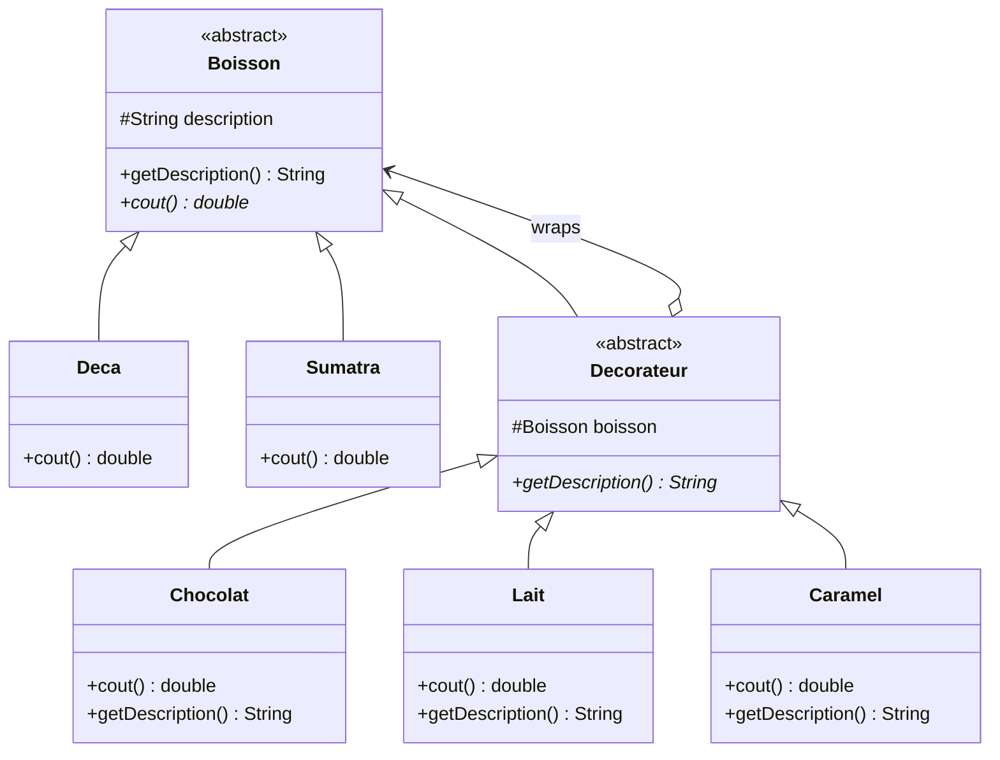
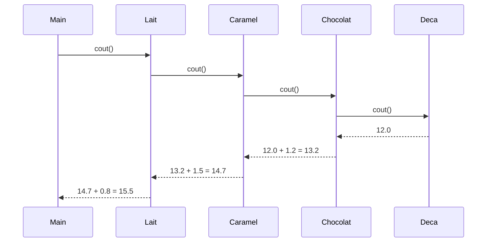
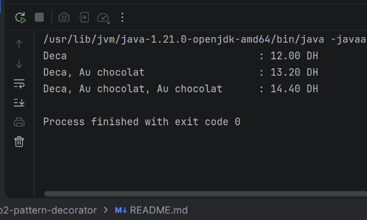

# TP3 — Decorator Design Pattern

A small Java console app that demonstrates the **Decorator** design pattern with a coffee shop example. You start from a base drink and **wrap** it with extras (chocolate, milk, caramel). Each extra adds to the price and to the description, and extras can be stacked in any order and any number of times.

## What is the Decorator pattern?

It adds behavior to an object **by wrapping it** in another object of the same type, instead of creating a subclass for every combination.

- **Component** (`Boisson`): the common type, for both drinks and extras.
- **Concrete components** (`Deca`, `Sumatra`): the base drinks.
- **Decorator** (`Decorateur`): an extra that *is* a `Boisson` and *holds* a `Boisson`.
- **Concrete decorators** (`Chocolat`, `Lait`, `Caramel`): each adds its own cost and name.

**Why not just subclasses?** With 2 drinks and 3 extras, you would need classes like `DecaChocolat`, `DecaLaitCaramel`, `SumatraChocolatChocolat`… The number of classes explodes. With decorators you write **one class per extra** and combine them at runtime:

```java
Boisson b = new Lait(new Caramel(new Chocolat(new Deca())));
```

## Class diagram



The key line is the double link between `Decorateur` and `Boisson`:

- `Decorateur` **extends** `Boisson`, so a decorated drink can be used anywhere a drink is expected.
- `Decorateur` **holds** a `Boisson`, so it can wrap a base drink or another decorator.

## How a call travels through the layers



Each layer asks the drink inside it, then adds its own part. `getDescription()` works the same way, which is why the base drink always appears first:

```
Lait( Caramel( Chocolat( Deca ) ) )
→ "Deca, Au chocolat, Au caramel, Au lait"
```

## Project structure

```
src/main/java/
├── Main.java
├── composants/
│   ├── Boisson.java      # Abstract component
│   ├── Deca.java         # Base drink — 12 DH
│   └── Sumatra.java      # Base drink — 6 DH
└── decorateurs/
    ├── Decorateur.java   # Abstract decorator
    ├── Chocolat.java     # + 1.2 DH
    ├── Lait.java         # + 0.8 DH
    └── Caramel.java      # + 1.5 DH
```

## Prices

| Type | Class | Price (DH) |
|---|---|---|
| Drink | `Deca` | 12.0 |
| Drink | `Sumatra` | 6.0 |
| Extra | `Chocolat` | + 1.2 |
| Extra | `Lait` | + 0.8 |
| Extra | `Caramel` | + 1.5 |

## Writing a decorator

Every decorator follows the same shape: call the wrapped drink, then add its own part.

```java
public class Chocolat extends Decorateur {

    public Chocolat(Boisson boisson) {
        super(boisson);
    }

    @Override
    public double cout() {
        return 1.2 + boisson.cout();
    }

    @Override
    public String getDescription() {
        return boisson.getDescription() + ", Au chocolat";
    }
}
```

**Common mistake:** using `super.getDescription()` instead of `boisson.getDescription()`. `super.getDescription()` reads the decorator's own `description` field, which is never set, so it prints `null, Au chocolat`.

To prevent this, `Decorateur` declares `getDescription()` as **abstract**. Any new decorator that forgets to override it will not compile.

## Adding a new extra

1. Create a class in `decorateurs/` that extends `Decorateur`.
2. Override `cout()` and `getDescription()`, both delegating to `boisson`.
3. Use it in `Main`. No existing class needs to change.

This follows the **Open/Closed principle**: the code is open to new extras but closed to modification.

## Run it

Requires **Java 21** and **Maven**.

```bash
mvn compile
java -cp target/classes Main
```

## Example output



```
Deca                                          : 12.00 DH
Sumatra, Au chocolat                          : 7.20 DH
Deca, Au chocolat, Au chocolat                : 14.40 DH
Sumatra, Au lait, Au caramel                  : 8.30 DH
Deca, Au chocolat, Au caramel, Au lait        : 15.50 DH
```